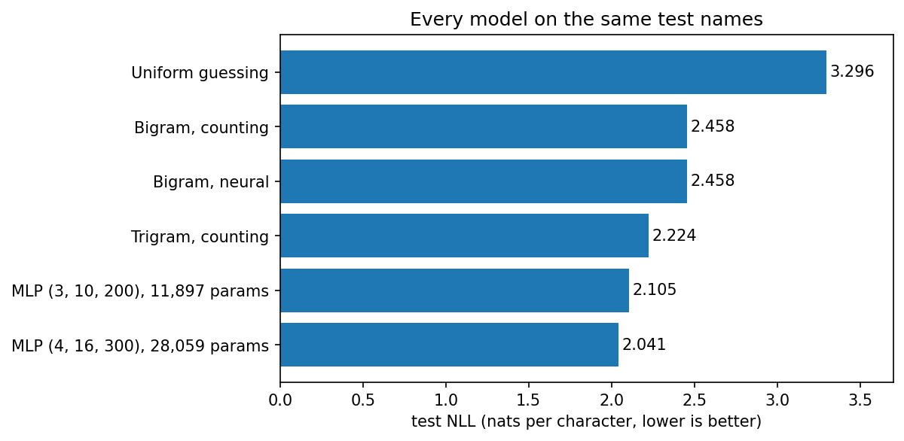
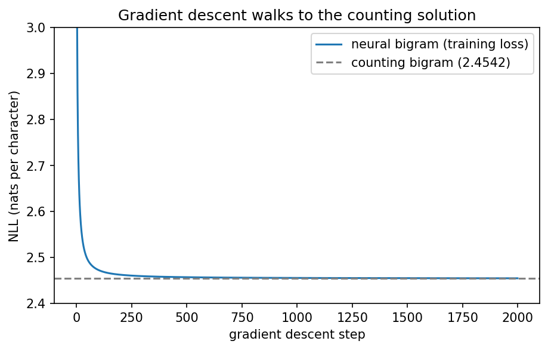
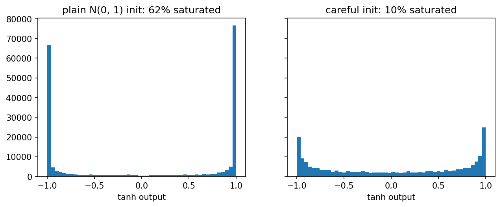
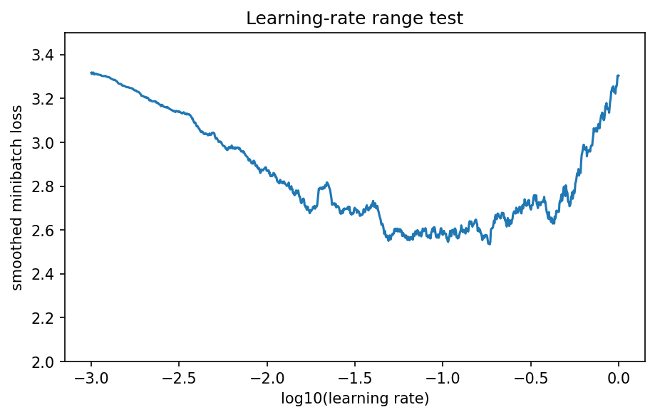
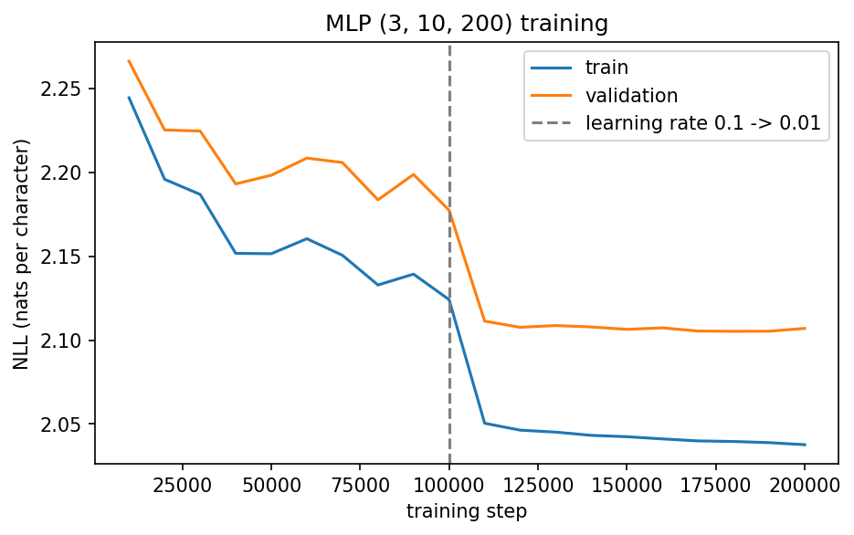
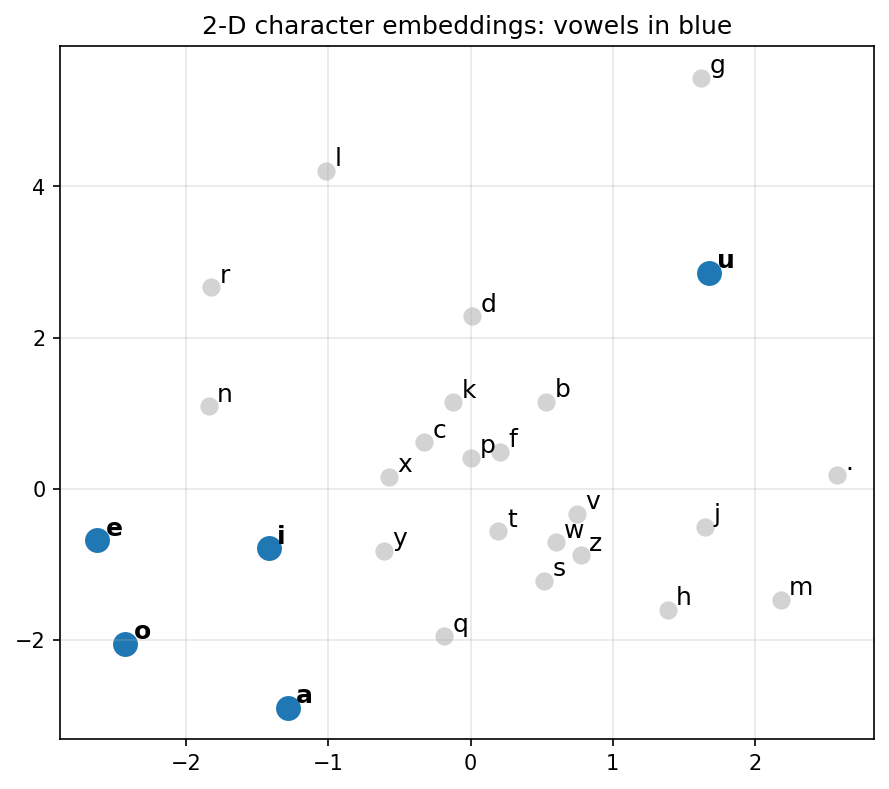

# Character-level MLP language model

This follows on from my [bigram/trigram name generator](https://github.com/vivekpandey0706/bigram-trigram-name-generator). The task is the same: learn from a list of 32,033 names and generate new ones, one character at a time. This time the models are neural networks. I first rebuilt the bigram as a one-layer network trained with gradient descent. Then I built the MLP from Bengio et al. (2003), which learns a vector for every character.

[](https://colab.research.google.com/github/vivekpandey0706/char-mlp-language-model/blob/main/Char_MLP_Language_Model.ipynb)

## Results

All numbers are the average negative log-likelihood per character on the test names, so lower is better. I touched the test set once, at the very end. Every choice before that was made on the validation set.

| Model | Size | Test NLL |
|---|---|---|
| Uniform guessing | - | 3.296 |
| Bigram, counting | 729 counts | 2.458 |
| Bigram, neural | 729 weights | 2.458 |
| Trigram, counting | 19,683 counts | 2.224 |
| MLP (context 3, embedding 10, hidden 200) | 11,897 params | 2.105 |
| MLP (context 4, embedding 16, hidden 300) | 28,059 params | 2.041 |

An easier way to read these numbers: at each step, the best model is about as unsure as picking between 7.7 equally likely characters. For the bigram it's 11.7, and for random guessing it's 27.

The smaller MLP beats the trigram with fewer numbers (11,897 vs 19,683). To be fair, it also sees one more character of context (3 instead of 2).



## Data

- 32,033 names, 27 characters (a-z plus `.`, which marks the start and end of a name)
- Split 80/10/10 into 25,626 train, 3,203 validation and 3,204 test names, the same split as Project 1, so all the losses can be compared

## Part 1: the bigram as a neural network

The bigram from Project 1 is just a 27x27 table of probabilities. You can get the same table from a one-layer network: one-hot the current character, multiply by a 27x27 weight matrix, apply softmax, and train with cross-entropy. Multiplying a one-hot vector by W just picks out one row of W, so the code indexes the row directly.

Before training anything, I checked a few things:

- All-zero weights give a loss of 3.2958, which is ln 27, the uniform-guessing loss.
- Setting the weights to the log of the counts gives 2.4531, exactly the counting model's validation loss.
- Adding 10 to every weight doesn't change the loss, because softmax only cares about differences.
- My softmax + NLL matches `F.cross_entropy`.

Then I trained it from random weights: 2,000 full-batch steps at a learning rate of 50. That sounds huge, but it's fine here, because each row's gradient gets scaled down by how rare that character is. The loss started at 3.758 and ended here:

| Split | Neural | Counting |
|---|---|---|
| Train | 2.4548 | 2.4542 |
| Val | 2.4531 | 2.4531 |
| Test | 2.4582 | 2.4580 |



The learned probabilities differ from the counted ones by at most 0.0175, and by 0.00036 on average. So gradient descent just finds the counting answer. The neural version isn't better for a bigram. The point is that, unlike a count table, it can be made bigger.

I also tried L2 regularization, which pulls the weights towards 0 (the uniform model), a bit like add-k smoothing. Each run was 500 steps:

| Lambda | Train | Val |
|---|---|---|
| 0 | 2.4571 | 2.4551 |
| 0.01 | 2.4612 | 2.4594 |
| 0.1 | 2.5032 | 2.5020 |
| 1 | 2.7212 | 2.7217 |
| 10 | 3.1315 | 3.1318 |

Every bit of regularization made it worse. The bigram's train and val losses are almost equal, so it isn't overfitting and there's nothing for regularization to fix.

The neural bigram's names are as bad as the counting ones: `dexze`, `momakurailezitynn`, `konimittain`, `staiyaubrtthrigotai`.

## Part 2: the MLP

This follows Bengio et al. (2003). Every character gets a learned vector, called its embedding. To predict the next character, the model takes the embeddings of the previous 3 characters, joins them into one vector, passes that through a tanh hidden layer, and then a linear layer gives 27 logits.

For "emma", the training examples look like this:

```
... -> e
..e -> m
.em -> m
emm -> a
mma -> .
```

That gives 182,625 training examples in total. The main model (context 3, embedding 10, hidden 200) has 11,897 parameters.

### Initialization

With plain N(0, 1) weights, the loss before any training was 26.12. That's way above ln 27 = 3.30, so the model starts out confidently wrong. Also, 62% of the tanh units were saturated: stuck near ±1, where the gradient is almost zero and they barely learn.

I fixed both by scaling the hidden weights by (5/3)/sqrt(fan_in) and starting the output layer small. After that, the first loss was 3.31 and only 10% of units were saturated.



### Training

- Minibatches of 32, for 200,000 steps.
- Learning rate 0.1 for the first half and 0.01 for the second. I chose 0.1 with a learning-rate range test (plot below).
- I measured the loss on the full train and validation sets every 10,000 steps, because single-batch losses are too noisy to compare.



By step 100k the validation loss had come down from 3.308 to 2.177. Lowering the learning rate gave an instant drop, to 2.111 by step 110k. After that it flattened out, and it finished at 2.038 train and 2.107 val.



### How big should it be?

| Context | Embedding | Hidden | Params | Train | Val | Gap |
|---|---|---|---|---|---|---|
| 3 | 2 | 200 | 6,881 | 2.154 | 2.179 | 0.025 |
| 3 | 10 | 200 | 11,897 | 2.038 | 2.107 | 0.069 |
| 3 | 16 | 300 | 23,259 | 1.995 | 2.089 | 0.094 |
| 4 | 16 | 300 | 28,059 | 1.843 | 2.049 | 0.207 |

Bigger models get a better validation loss, but the gap between train and val keeps growing, from 0.025 to 0.207. The biggest model is clearly starting to overfit. I trained it for 300k steps, but its val loss was lowest at 200k (2.042) and went back up to 2.049 by the end, even though the train loss kept falling. Stopping earlier would have helped a little. It still has the best val loss, so it's the one I tested.

### Names from the best model

```
cexi, kaegan, raileigha, kell, imitra, nolliver, andr, samiyah,
jaxsiyi, taimie, jenan, kinzleeda, kaleyda, sade, eniavi
```

These look far more like names than the bigram's did. A few could be real names (samiyah, sade), and most at least sound like one.

### Character embeddings

The 6,881-parameter model uses 2-D embeddings, so every character can be plotted directly. Vowels are in blue.



## What I learned

The neural bigram landed on exactly the same answer as counting. It's the same maximum-likelihood problem solved a different way, and the real gain is that the network can grow. Checking the starting loss against ln 27 turned out to be a very cheap test that catches a bad initialization straight away. The embeddings are what let the MLP share what it learns between similar characters, which is how it beats the trigram with fewer numbers. And a bigger model isn't automatically better: the train-val gap is what tells you when it starts to memorise.

## Next

- Add batch normalization to the hidden layer
- Try longer contexts with a WaveNet-style model that merges characters in stages
- I trained a Transformer on Shakespeare in my [mini-gpt](https://github.com/vivekpandey0706/mini-gpt) repo, and I'd like to try one on these names too

## Running it

Open the notebook in Colab and click Run all. It downloads the names file itself, and the whole thing takes about 10-15 minutes.

## Credits

The MLP follows Bengio, Ducharme, Vincent and Jauvin (2003), [A Neural Probabilistic Language Model](https://www.jmlr.org/papers/volume3/bengio03a/bengio03a.pdf). The names dataset and the overall approach come from Andrej Karpathy's [makemore](https://github.com/karpathy/makemore) series.
